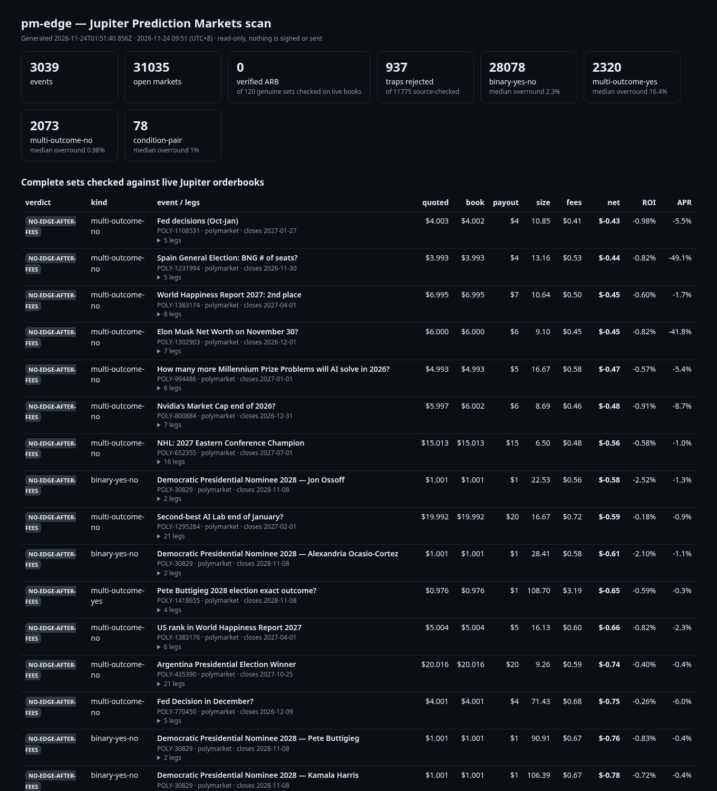

# pm-edge

**Complete-set arbitrage and price-integrity scanner for Jupiter Prediction Markets on Solana.**

Jupiter Prediction lets one Solana wallet trade Polymarket- and Kalshi-sourced markets. That makes a classic
prediction-market trade, buying a *complete set* (every outcome) for less than it pays out, executable from
Solana. It also makes it easy to lose money: most baskets that look like free money on quotes are not complete sets.

`pm-edge` scans every high-volume Jupiter Prediction event and answers three questions with live data:

1. **Is there a genuine, fee-positive complete set right now?** Depth-aware, net of Jupiter's fee schedule and
   $5 order minimum, with ROI annualised to the market's close date and ready-to-POST order bodies.
2. **Is it really a complete set?** Every multi-outcome basket is checked against the source venue
   (Polymarket `negRisk` / `negRiskAugmented`, Kalshi `mutually_exclusive`) and against the venue's full outcome list.
3. **Does trading through Jupiter cost more than trading on the native venue?** Jupiter quotes vs the live
   Polymarket CLOB / Kalshi order book, in cents.

It is read-only. It never holds keys, signs, or sends a transaction.



## Results from a live run (2026-11-24 09:51 UTC+8)

Full output: [`samples/report.md`](samples/report.md) · [`samples/report.html`](samples/report.html) · [`samples/scan.json`](samples/scan.json) · [`samples/console.txt`](samples/console.txt)

| | |
|---|---|
| Events scanned (top 3,000 Polymarket by volume + all 39 Kalshi) | **3,039** events, **31,035** open markets |
| Complete-set baskets built | 28,078 YES+NO · 2,320 multi-outcome YES · 2,073 multi-outcome NO · 78 split-condition pairs |
| Baskets that are **not** complete sets (rejected at the source venue) | **937**, of which **869** have quotes summing to less than their payout, so a naive "sum of prices < $1" bot would buy them |
| Why rejected | 816 not mutually exclusive (cumulative "by date…" ladders, win totals) · 121 non-exhaustive (Polymarket `negRiskAugmented` placeholders such as "Team A" / "Other") |
| Genuine sets checked on live order books | 120 → **0 fee-positive**. The closest, *Fed decisions (Oct–Jan)* NO-basket at $4.002 for a $4 payout, loses $0.43 after fees on 11 sets. 77 more are quoted but have no fillable depth on at least one leg |
| Jupiter vs native venue (40 top-volume markets each) | Polymarket: median 0.00¢, 100% within ±1¢ · Kalshi: median 0.00¢, 100% within ±1¢ |

What it means: today Jupiter's quotes track the source venues to the cent and genuine complete sets sit just
under the fee floor. A real edge only shows up when one venue moves before the other, so `pm-edge watch`
exists to catch it. Meanwhile, the trap filter alone stops close to 900 false positives per scan.

### Example trap

`AFC Asian Cup 2027: Group F Winner` (`POLY-994372`): Jupiter quotes YES on all four listed teams for **$0.177** total.
That looks like an 82% risk-free return. It isn't: the Polymarket event is `negRiskAugmented` with inactive placeholder
outcomes ("Team A", "Team B", "Other"), so the four listed teams can all resolve NO. `pm-edge` rejects it, and
`test/exclusivity.test.ts` pins that rejection using the recorded live payloads.

## How it works

```
             GET /prediction/v1/events (sortBy=volume, per provider)
                              │
                              ▼
   buildCandidates ── binary YES+NO · split-condition pair · multi-outcome YES · multi-outcome NO
                              │   (listing quotes only, no extra calls)
                              ▼
   screen: quoted cost ≤ payout × (1 + 1%)
                              │
                              ▼
   checkExclusivity ── Polymarket gamma /events/{id}: negRisk, negRiskAugmented, open condition ids
   (memoised per event)  Kalshi /events/{ticker}: mutually_exclusive, open tickers
                              │   rejected → TRAP · unknown → UNVERIFIED (never ARB)
                              ▼
   GET /prediction/v1/orderbook/{marketId}  (one fetch per leg; NO bid at p = YES ask at 1−p)
                              │
                              ▼
   sizeCompleteSet ── walk every leg's ladder at once, evaluate each depth breakpoint,
                      Jupiter fee per leg, $5 minimum per leg, budget cap, APR to close
                              │
                              ▼
   verdict: ARB · NO-EDGE-AFTER-FEES · NO-DEPTH · NOT-A-COMPLETE-SET · UNVERIFIED
   + orderPlan: POST /prediction/v1/orders bodies (unsigned, never sent)
```

**Complete-set rules**

| kind | basket | pays | needs |
|---|---|---|---|
| `binary-yes-no` | YES + NO of one market | $1 | nothing, complete by construction |
| `condition-pair` | YES on both Jupiter markets split from one Polymarket binary condition (e.g. "Bengals" / "Commanders") | $1 | nothing, same `conditionId` |
| `multi-outcome-yes` | YES on every outcome | $1 | mutually exclusive **and** exhaustive (Polymarket `negRisk` without `negRiskAugmented` or placeholders, and Jupiter lists every open outcome). Kalshi has no exhaustiveness flag, so these stay UNVERIFIED |
| `multi-outcome-no` | NO on every outcome | ≥ $(n−1) | mutually exclusive only (if nothing wins, it pays $n) |

**Fee model.** Jupiter publishes a fee table rather than a formula. `ceil_to_cent(0.07 × contracts × p × (1−p))`
reproduces all 18 published values exactly, and `test/fees.test.ts` pins every one of them, so a schedule change
breaks the build instead of silently mis-pricing. Each leg's fee is charged on its volume-weighted average price.
Because p(1−p) is concave, that is never lower than charging each fill separately.

**Design choices**

- **Zero runtime dependencies.** Node ≥ 22.18 runs the TypeScript directly (type stripping). The only dev
  dependency is `typescript` for `tsc --noEmit`.
- **Source of truth over heuristics.** It never guesses from titles whether outcomes are exclusive. It asks the venue.
- **Fails closed.** A failed source lookup gives UNVERIFIED and an empty ladder gives NO-DEPTH. Neither can become ARB.
- **Bounded, polite I/O.** Retries only 429/5xx, uses a concurrency limiter, memoises event lookups, and fetches each order book once.

## Setup

```bash
git clone <this repo> && cd jup-pm-edge
npm install            # dev-only: typescript + @types/node
npm test               # 30 offline tests on recorded live payloads (+2 live tests, skipped by default)
npm run test:live      # hits the real APIs
npm run typecheck
```

Optional: `export JUP_API_KEY=jup_...` (from developers.jup.ag/portal) for higher rate limits. The public endpoints used here work without a key.
Jupiter blocks US and South Korea IPs from the Prediction API.

## Usage

```bash
# Full scan + 40-market integrity sample per venue, writing report.md / report.html / scan.json
node src/cli.ts scan --integrity-sample 40 --out samples

# Kalshi only, smaller budget, verify more books
node src/cli.ts scan --provider kalshi --budget 250 --max-verify 300

# Machine-readable output
node src/cli.ts scan --json > scan.json

# Price integrity only
node src/cli.ts integrity --sample 60 --out out-integrity

# Re-render reports from a saved scan
node src/cli.ts render samples/scan.json --out samples

# Watch mode: rescan every 2 minutes, print one JSON line per new fee-positive basket ≥ $1 net
node src/cli.ts watch --interval 120 --min-profit 1
```

An ARB row in `scan.json` carries `orders`, one body per leg for `POST https://api.jup.ag/prediction/v1/orders`:

```json
{"ownerPubkey":"<YOUR_WALLET_PUBKEY>","marketId":"POLY-5154351","isYes":false,"isBuy":true,
 "contracts":"10.85","depositAmount":"5191851","depositMint":"EPjFWdd5AufqSSqeM2qN1xzybapC8G4wEGGkZwyTDt1v"}
```

That is the real `orderPlan()` output for the first leg of the closest basket in the live run (*Fed decisions (Oct–Jan)*,
NO on all 5). It shows the format only: the basket was not fee-positive, so the scan itself did not attach orders to it.

## Project layout

```
src/
  cli.ts           scan · integrity · render · watch
  scan.ts          two-stage pipeline (structure check → order books → sizing), trap reporting
  completeSet.ts   basket construction, depth-aware sizing, order plan
  integrity.ts     Jupiter vs Polymarket CLOB / Kalshi book
  jupiter.ts       Jupiter Prediction client (events, orderbook, trading-status)
  venues.ts        Polymarket gamma + CLOB, Kalshi events + orderbook
  fees.ts          Jupiter fee schedule
  orderbook.ts     ladder parsing, YES/NO ask derivation, cost walking
  http.ts          fetch with timeout/retry, concurrency limiter
  report.ts        console, Markdown, HTML
test/              node:test suites + fixtures/ (recorded live API payloads, 2026-11-24)
samples/           output of the live run above
```

## Limitations

- Jupiter's Prediction API is in beta. The fee model is fitted to the published table, and fills on
  Polymarket-routed orders may differ slightly from the Jupiter order book snapshot.
- A complete set pays out at resolution, so capital is locked until then. APR uses the market close time, and
  real resolution can come later.
- Venue rule differences, disputes, and 50-50 resolutions are outside the model. A 50-50 resolution still pays a
  complete set $1.
- This is analysis, not financial advice.

## License

MIT
