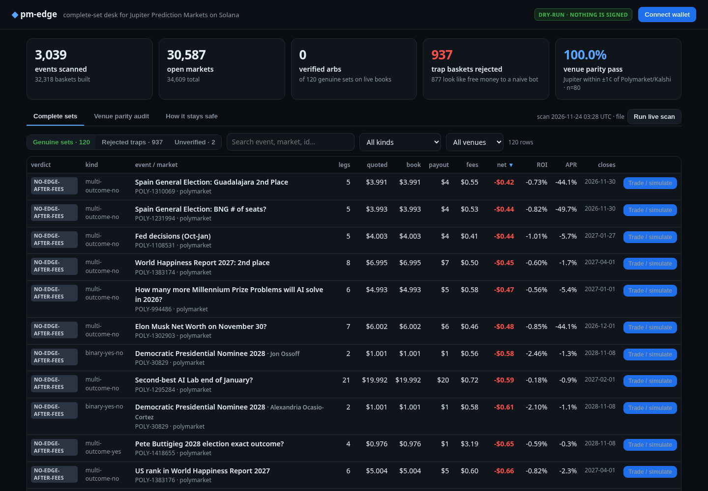
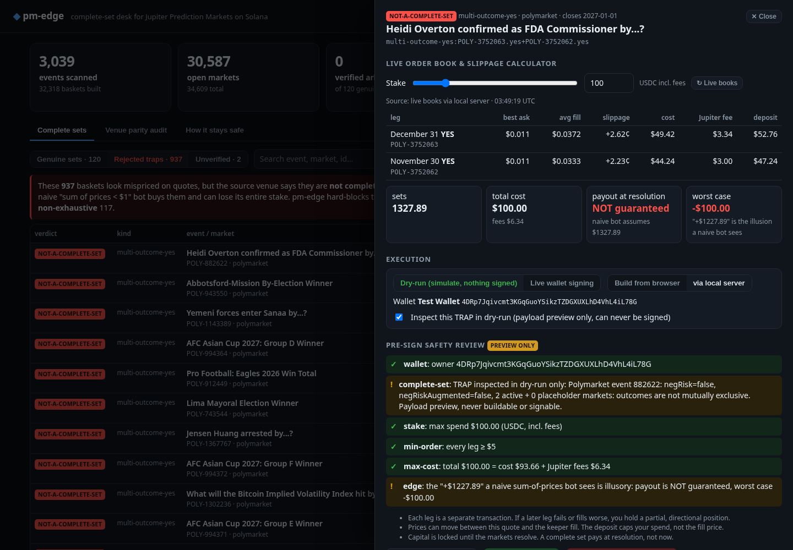

# pm-edge

**Complete-set arbitrage and price-integrity scanner for Jupiter Prediction Markets on Solana.**

Jupiter Prediction lets one Solana wallet trade Polymarket- and Kalshi-sourced markets. That makes a classic
prediction-market trade, buying a *complete set* (every outcome) for less than it pays out, executable from
Solana. It also makes it easy to lose money: most baskets that look like free money on quotes are not complete sets.

`pm-edge` scans every high-volume Jupiter Prediction event and answers three questions with live data:

1. **Is there a genuine, fee-positive complete set right now?** Depth-aware, net of Jupiter's fee schedule and
   $5 order minimum, with ROI annualised to the market's close date and ready-to-POST order bodies.
2. **Is it really a complete set?** Every multi-outcome basket is checked against the source venue
   (Polymarket `negRisk` / `negRiskAugmented`, Kalshi `mutually_exclusive`) and against the venue's full outcome list.
3. **Does trading through Jupiter cost more than trading on the native venue?** Jupiter quotes vs the live
   Polymarket CLOB / Kalshi order book, in cents.

It ships as a **CLI** and as a **dark-mode web desk** (`npm start`) that goes from scan to a wallet-signed
order without ever holding a key: the browser wallet signs, pm-edge only builds and checks.



## Quick start (30 seconds, no wallet, no funds)

```bash
npm install && npm start          # → http://127.0.0.1:8787  (serves samples/scan.json; "Run live scan" refreshes it)
```

Or open the static demo with **no server at all**: [`samples/demo.html`](samples/demo.html) (same UI, the real scan
embedded, order books and order builds go straight from your browser to Jupiter).

1. **Rejected traps** toggle → expand a row: why a naive "sum of prices < $1" bot loses its stake there.
2. **Genuine sets** → *Trade / simulate*: slide the stake $25 → $500 and watch live depth and Jupiter's fee curve move net P&L.
3. *Use watch-only demo key* → **Build unsigned orders** → **Simulate**. Real `POST /prediction/v1/orders`, RPC
   `simulateTransaction`, nothing signed. (From a US/KR IP Jupiter answers `unsupported_region`; the UI says so and
   still shows the exact request body.)
4. Open a trap → switch to **Live wallet signing**: hard-blocked, the wallet is never asked.

## The dashboard

| | |
|---|---|
| KPI cards | events scanned · open markets · verified arbs · trap baskets rejected · venue parity pass rate |
| Complete sets | filter (search, kind, venue), sort any numeric column, Genuine / Rejected traps / Unverified toggle. Rows show legs, Jupiter quote vs live book best ask, fees, net, ROI, APR; expand for per-leg prices and, on traps, the plain-English reason a naive bot loses |
| Venue parity audit | Jupiter buy/sell vs Polymarket CLOB and Kalshi book per market, in cents |
| Trade drawer | live order books (from your browser or the local server), stake slider $25–$500 with depth-walked fills, slippage, Jupiter fee per leg, deposit per leg, net P&L. On traps it shows the payout as **not guaranteed** and the worst case, never a "profit" |
| Wallets | any Wallet Standard wallet (Phantom, Solflare, …) plus legacy `window.phantom.solana` / `window.solflare` / `window.solana`. Public key only |
| Execution | pre-sign safety review → build unsigned txs via Jupiter `POST /orders` → decode each tx in the browser and check the fee payer / signers are your wallet → **dry-run**: `simulateTransaction` (sigVerify off) · **live**: wallet `signTransaction` + Jupiter `/execute` (falls back to `signAndSendTransaction`), confirm dialog, stops at the first failed leg |



### Safety model

- **No keys, ever.** No private key, seed phrase or secret is requested, stored, logged or sent. The server has
  no wallet code at all; signing happens only inside the user's wallet extension, after a confirm dialog.
- **Trap baskets are hard-blocked.** `src/safety.ts` `reviewExecution()` (shared by browser and server) blocks
  live execution of any NOT-A-COMPLETE-SET basket outright. In dry-run a trap can be *inspected* only after an
  explicit tick, and then only as a payload preview: Jupiter is not called and nothing can be signed.
- **The server does not trust the client.** `POST /api/orders/build` looks the basket up in its own scan, re-runs
  the review with its own verdict, and prices live mode only on live books. A modified page cannot unblock a trap.
- **Other gates:** UNVERIFIED baskets are preview-only; every leg must meet Jupiter's $5 minimum; deposits are
  sized so their sum never exceeds the stake; stake hard cap ($1,000); negative edge needs an explicit
  acknowledgement before live signing; empty books block.
- **Every unsigned tx is decoded before the wallet sees it** (legacy and v0): the fee payer must be the connected
  wallet; extra required signers are flagged.
- **Disclosed risks on every review:** legs are separate transactions (partial-fill risk), prices can move before
  the keeper fill, capital is locked until resolution.
- HTTP server: binds `127.0.0.1` by default, strict CSP, `nosniff`, `no-referrer`, no directory serving, 64 KB body limit.

## Results from a live run (2026-11-24 11:28 UTC+8)

Full output: [`samples/report.md`](samples/report.md) · [`samples/report.html`](samples/report.html) · [`samples/scan.json`](samples/scan.json) · [`samples/console.txt`](samples/console.txt)

| | |
|---|---|
| Events scanned (top 3,000 Polymarket by volume + all 39 Kalshi) | **3,039** events, **30,587** open markets (34,609 total) |
| Complete-set baskets built | 27,844 YES+NO · 2,330 multi-outcome YES · 2,081 multi-outcome NO · 63 split-condition pairs |
| Baskets that are **not** complete sets (rejected at the source venue) | **937**, of which **877** have quotes summing to less than their payout, so a naive "sum of prices < $1" bot would buy them |
| Why rejected | 820 not mutually exclusive (cumulative "by date…" ladders, win totals) · 117 non-exhaustive (Polymarket `negRiskAugmented` placeholders such as "Team A" / "Other") |
| Genuine sets checked on live order books | 120 → **0 fee-positive**. Closest: *Spain General Election: Guadalajara 2nd Place*, NO on all 5 at $3.991 for a $4 payout, loses $0.42 after fees on 14 sets. 74 more are quoted but have no fillable depth on at least one leg |
| Jupiter vs native venue (40 top-volume markets each) | Polymarket: median 0.00¢, 100% within ±1¢ · Kalshi: median 0.00¢, 100% within ±1¢ |

What it means: today Jupiter's quotes track the source venues to the cent and genuine complete sets sit just
under the fee floor. A real edge only shows up when one venue moves before the other, so `pm-edge watch`
exists to catch it. Meanwhile, the trap filter alone stops close to 900 false positives per scan.

### Example trap

`AFC Asian Cup 2027: Group F Winner` (`POLY-994372`): Jupiter quotes YES on all four listed teams for well under $1
(**$0.177** when the test fixtures were recorded). That looks like a risk-free return. It isn't: the Polymarket event is `negRiskAugmented` with inactive placeholder
outcomes ("Team A", "Team B", "Other"), so the four listed teams can all resolve NO. `pm-edge` rejects it,
`test/exclusivity.test.ts` pins that rejection using the recorded live payloads, and `test/server.test.ts` proves the
server refuses to build it.

## How it works

```
             GET /prediction/v1/events (sortBy=volume, per provider)
                              │
                              ▼
   buildCandidates ── binary YES+NO · split-condition pair · multi-outcome YES · multi-outcome NO
                              │   (listing quotes only, no extra calls)
                              ▼
   screen: quoted cost ≤ payout × (1 + 1%)
                              │
                              ▼
   checkExclusivity ── Polymarket gamma /events/{id}: negRisk, negRiskAugmented, open condition ids
   (memoised per event)  Kalshi /events/{ticker}: mutually_exclusive, open tickers
                              │   rejected → TRAP · unknown → UNVERIFIED (never ARB)
                              ▼
   GET /prediction/v1/orderbook/{marketId}  (one fetch per leg; NO bid at p = YES ask at 1−p)
                              │
                              ▼
   sizeCompleteSet ── walk every leg's ladder at once, evaluate each depth breakpoint,
                      Jupiter fee per leg, $5 minimum per leg, budget cap, APR to close
                              │
                              ▼
   verdict: ARB · NO-EDGE-AFTER-FEES · NO-DEPTH · NOT-A-COMPLETE-SET · UNVERIFIED
   + orderPlan: POST /prediction/v1/orders bodies (unsigned, never sent)
```

**Dashboard architecture**

```
 browser (web/app.js, wallet.js)                     node:http server (src/server.ts), 127.0.0.1 only
 ├─ /lib/pricing.js  ◄── src/pricing.ts  (same code, TypeScript stripped at serve time)
 ├─ /lib/safety.js   ◄── src/safety.ts   (same review the server enforces)
 ├─ GET  /api/scan/latest · POST /api/scan (async, 409 if running) · GET /api/scan/status
 ├─ GET  /api/basket/:id/quote?stake=     live Jupiter books → quoteStake (snapshot fallback)
 ├─ POST /api/orders/build                server-side review → Jupiter POST /orders per leg → tx check
 ├─ POST /api/simulate                    RPC simulateTransaction (sigVerify false)
 └─ POST /api/orders/execute              relays an already-signed tx to Jupiter /execute
 wallet: Wallet Standard / legacy providers → signTransaction / signAndSendTransaction (keys never leave it)

 static demo (src/demo.ts → samples/demo.html, site/index.html): one file, CSS + modules inlined through an
 import map of data: URLs, scan embedded; "browser" route only, so it runs on GitHub Pages / Cloudflare Pages.
```

**Complete-set rules**

| kind | basket | pays | needs |
|---|---|---|---|
| `binary-yes-no` | YES + NO of one market | $1 | nothing, complete by construction |
| `condition-pair` | YES on both Jupiter markets split from one Polymarket binary condition (e.g. "Bengals" / "Commanders") | $1 | nothing, same `conditionId` |
| `multi-outcome-yes` | YES on every outcome | $1 | mutually exclusive **and** exhaustive (Polymarket `negRisk` without `negRiskAugmented` or placeholders, and Jupiter lists every open outcome). Kalshi has no exhaustiveness flag, so these stay UNVERIFIED |
| `multi-outcome-no` | NO on every outcome | ≥ $(n−1) | mutually exclusive only (if nothing wins, it pays $n) |

**Fee model.** Jupiter publishes a fee table rather than a formula. `ceil_to_cent(0.07 × contracts × p × (1−p))`
reproduces all 18 published values exactly, and `test/fees.test.ts` pins every one of them, so a schedule change
breaks the build instead of silently mis-pricing. Each leg's fee is charged on its volume-weighted average price.
Because p(1−p) is concave, that is never lower than charging each fill separately.

**Design choices**

- **Zero runtime dependencies.** Node ≥ 22.18 runs the TypeScript directly (type stripping). The only dev
  dependency is `typescript` for `tsc --noEmit`.
- **Source of truth over heuristics.** It never guesses from titles whether outcomes are exclusive. It asks the venue.
- **Fails closed.** A failed source lookup gives UNVERIFIED and an empty ladder gives NO-DEPTH. Neither can become ARB.
- **Bounded, polite I/O.** Retries only 429/5xx, uses a concurrency limiter, memoises event lookups, and fetches each order book once.

## Setup

```bash
git clone <this repo> && cd jup-pm-edge
npm install            # dev-only: typescript + @types/node
npm test               # 60 offline tests (pricing, safety, server endpoints, demo, scanner) + 2 live, skipped by default
npm run test:live      # hits the real APIs
npm run test:ui        # headless Chrome over CDP: drives the dashboard, mock wallet, writes docs/dashboard-*.png
npm run typecheck
```

Optional: `export JUP_API_KEY=jup_...` (from developers.jup.ag/portal) for higher rate limits. The public endpoints used here work without a key.
Jupiter blocks US and South Korea IPs from Prediction **trading** (`POST /orders` returns `unsupported_region`;
reads still work). So: run the dashboard locally (`npm start`), or host only the static demo, where every Jupiter
call comes from the viewer's own browser. Do not put the server on a US/KR host.

## Deployment

```bash
npm start                                   # local desk on http://127.0.0.1:8787 (pm-edge serve --port --host --data)
npm run build-demo                          # → samples/demo.html + site/index.html (self-contained, ~1.9 MB)
npx wrangler deploy                         # optional: Cloudflare static assets from ./site (wrangler.toml)
# GitHub Pages: publish site/ (or samples/demo.html) as-is
```

`wrangler.toml` deliberately ships static assets only, with no Worker script: a Worker runs at whichever edge
location serves the request, which can be a geo-blocked region for Jupiter trading.

## Usage

```bash
# Full scan + 40-market integrity sample per venue, writing report.md / report.html / scan.json
node src/cli.ts scan --integrity-sample 40 --out samples

# Kalshi only, smaller budget, verify more books
node src/cli.ts scan --provider kalshi --budget 250 --max-verify 300

# Machine-readable output
node src/cli.ts scan --json > scan.json

# Price integrity only
node src/cli.ts integrity --sample 60 --out out-integrity

# Re-render reports from a saved scan
node src/cli.ts render samples/scan.json --out samples

# Watch mode: rescan every 2 minutes, print one JSON line per new fee-positive basket ≥ $1 net
node src/cli.ts watch --interval 120 --min-profit 1
```

An ARB row in `scan.json` carries `orders`, one body per leg for `POST https://api.jup.ag/prediction/v1/orders`:

```json
{"ownerPubkey":"<YOUR_WALLET_PUBKEY>","marketId":"POLY-5154351","isYes":false,"isBuy":true,
 "depositAmount":"11874009","depositMint":"EPjFWdd5AufqSSqeM2qN1xzybapC8G4wEGGkZwyTDt1v"}
```

That is real `orderBodies()` output for the first leg of *Fed decisions (Oct–Jan)* (NO on all 5) at a $100 stake on the
saved book snapshot. Buys are sized by `depositAmount` (USDC base units, fees included); contract-quantity fields
are for sells only. It shows the format only: that basket loses $1.00 at this size, so the scan did not attach orders.

## Project layout

```
web/
  index.html, app.css, app.js   dashboard (no framework, no build step)
  wallet.js        Wallet Standard + legacy provider adapter (public key + sign calls only)
src/
  cli.ts           scan · integrity · render · watch · serve · build-demo
  server.ts        node:http dashboard server + JSON API (see above)
  safety.ts        pre-sign review, base58, unsigned-tx decoder (shared with the browser)
  pricing.ts       fee curve, ladders, stake quotes (shared with the browser)
  demo.ts          single-file static demo builder
  scan.ts          two-stage pipeline (structure check → order books → sizing), trap reporting
  completeSet.ts   basket construction, depth-aware sizing, order plan
  integrity.ts     Jupiter vs Polymarket CLOB / Kalshi book
  jupiter.ts       Jupiter Prediction client (events, orderbook, POST /orders, /execute)
  venues.ts        Polymarket gamma + CLOB, Kalshi events + orderbook
  fees.ts          Jupiter fee schedule
  orderbook.ts     ladder parsing, YES/NO ask derivation, cost walking
  http.ts          fetch with timeout/retry, concurrency limiter
  report.ts        console, Markdown, HTML
test/              node:test suites + fixtures/ (recorded live API payloads, 2026-11-24)
samples/           output of the live run above + demo.html
site/              static-hosting copy of the demo (wrangler.toml points here)
docs/              screenshots
```

## Limitations

- Jupiter's Prediction API is in beta. The fee model is fitted to the published table, and fills on
  Polymarket-routed orders may differ slightly from the Jupiter order book snapshot.
- A complete set pays out at resolution, so capital is locked until then. APR uses the market close time, and
  real resolution can come later.
- Venue rule differences, disputes, and 50-50 resolutions are outside the model. A 50-50 resolution still pays a
  complete set $1.
- Each leg is its own transaction. If a later leg fails, you hold a partial, directional position; the UI stops at the
  first failure and says so, but cannot undo filled legs.
- Wallet support is tested with a mock Wallet Standard wallet in headless Chrome (`test/ui-smoke.ts`); real-wallet
  live execution could not be exercised from the build machine because Jupiter geo-blocks its region.
- This is analysis, not financial advice.

## License

MIT
